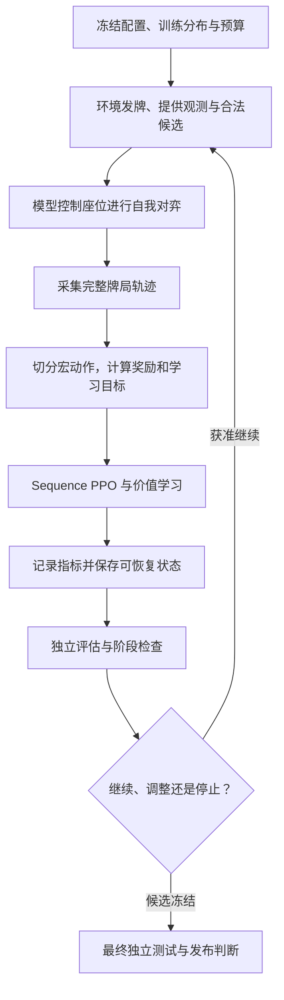

# 00 · 项目全景：先看懂我们在做什么

[项目入口](../../README.md) · [下一篇：架构与数据流](01_architecture.md) · [术语表](glossary.md)

> 适用范围：MARVEL v1.4 宏决策 IPPO 阅读主线。性质：当前机制与阅读地图。代码核对：2026-10-21。动态状态只在 [CURRENT_EXECUTION.md](../marvel_v14_prompts/CURRENT_EXECUTION.md) 维护；本篇不是新的训练授权或验收报告。

## 读完应该能回答什么？

1. 项目训练的是什么，不是什么？
2. 游戏、模型、训练器、评估器怎么合作？
3. 哪些文档代表当前说明，哪些只是历史记录？
4. “能运行”和“棋力已提高”差在哪里？

## 1. 一句话解释项目

我们希望训练一个能与队友合作打掼蛋的策略模型。模型看自己的手牌和公开历史，从合法选择里作决策；训练系统让它反复打牌，根据最后的队伍收益调整参数。

可以把系统想成四种角色：

| 角色 | 通俗理解 | 它不负责什么 |
|---|---|---|
| 规则引擎 | 裁判：判断牌型、轮次、合法性和结果 | 不告诉模型最优打法 |
| 策略模型 | 牌手：根据可见信息选择动作 | 不得读取其他人的隐藏手牌 |
| 训练器 | 教练：用结果和轨迹更新参数 | 不替代规则裁判，也不自动证明棋力 |
| 评估器 | 考官：在隔离的数据和固定协议上比较模型 | 不应把最终考试数据用于反复调参 |

训练的模型使用 Transformer 等神经网络组件，但不是通用聊天模型。这里的 token 主要是牌局事件和动作协议的编号，不是自然语言单词。

## 2. 项目的范围与非目标

项目处理四人两队的掼蛋牌局：0/2 为一队，1/3 为另一队；双副牌共 108 张，初始每人 27 张。“一局”在训练中通常指一次发牌到本局终止，**不等于一场从某级打到终点的完整比赛**。级牌、先手和上一局结果是环境上下文的一部分。

目标包括：

- 可测试、可复现的规则与环境；
- 高效采集完整牌局，自我对弈训练策略；
- 保存、恢复与交付训练过程；
- 用隔离、可追溯的评估检验候选模型。

不能从项目文件存在就推导出的结论：

- 不能说所有地方掼蛋规则都支持；以项目规则和测试为准。
- 不能说单局评估等价于完整多副比赛水平。
- 不能说阶段验收通过等价于当前源码已完成 Kaggle 双 T4 认证。
- 不能说有 Value Head 就已实现搜索。
- FableDan 仅用于单独授权的外部评估，不能作为教师、监督标签或训练数据。

## 3. 从一局牌到一个模型的闭环

如果阅读器不支持 Mermaid，按上面的文字顺序阅读即可：**配置 → 打牌 → 收集 → 学习 → 保存 → 评估 → 决策**。

### 一个贯穿本套指南的例子

下面都是教学示意，不是实验结果，也不是某个固定配置必定产生的轨迹：

1. 座位 0 看见自己的手牌与公开牌局信息。
2. 它依次选择动作协议 token，构造一次出牌，在 `COMMIT` 时真正交给规则引擎；`PASS` 本身也构成一次完整决定。
3. 其他玩家行动，然后可能再次轮到座位 0。
4. 一局结束，按队伍名次结果获得奖励。
5. 训练器把此前每次完整决定与其优势目标对应，更新模型。
6. 另用评估发牌比较更新前后模型，不能直接用训练收益宣布变强。

[架构篇](01_architecture.md)追踪数据经过哪里；[训练篇](02_training.md)解释第 5 步如何计算；[评估篇](04_evaluation.md)解释第 6 步为什么必要。

## 4. 当前主线与历史版本的关系

| 文档/代码家族 | 当时解决的问题 | 现在怎么用 |
|---|---|---|
| A00–A11、`guandan/` 早期训练链 | 建立规则、逐步动作、环境、早期训练与验收 | 规则和专项契约仍有价值；旧训练入口不能当 v1.4 操作指南 |
| M00–M10、`docs/marvel_migration/` | 迁移 MARVEL 通用核心，建立 V2、C++、DDP、评估与交付 | 读架构和专项协议；迁移末尾状态是历史记录 |
| M09 / Bootcamp Week-1 | 旧模型正式运行、诊断和旧训练配方 | 研究历史结果与设计动机；不照抄为当前配方 |
| v1.4 阶段 1–4 | 宏动作 PPO/GAE、Actor Fuse、AMP、奖励和上下文 | 当前主线原理的重要依据 |
| v1.4 阶段 5–6 | 条件对称性、Belief 预检、训练对手池、Value/Search 闸门 | 是否启用和是否具备资格，必须查当前入口与实际配置 |

这里的“主线”描述推荐阅读的训练路径，**不表示 Python 配置类的每个默认值都已切换到 v1.4**。兼容默认值、交付 profile、运行实际 resolved config 是三件事。

## 5. 什么才算完成？

| 层次 | 需要的证据 | 不能越级声称 |
|---|---|---|
| 设计 | 方案、接口和验收定义 | 已经实现 |
| 实现 | 实际代码与对应测试 | 已通过独立验收 |
| 工程验收 | 明确范围的测试、报告、身份核对 | 当前生产环境都能稳定运行 |
| 目标环境验证 | 当前源码、真实设备和配置上的启动、有效更新、保存恢复 | 长训结束或棋力提高 |
| 正式训练 | 实际完成迭代/局数、日志、checkpoint | 优于旧模型 |
| 棋力验证 | 数据隔离、足够样本、公平协议、统计结果 | 超出规则/上下文/对手范围的普遍强度 |

即使历史模型完成过正式训练，也不意味着修改过的新版本继承了同样的验证结论。

## 6. 文档地图与冲突处理

### 当前入门说明

- [00 项目全景](00_overview.md)：项目目标、阅读地图和完成层次。
- [01 架构与数据流](01_architecture.md)：模块、信息边界、轨迹与产物。
- [02 训练原理](02_training.md)：模型、Sequence PPO、GAE、配方与迭代。
- [03 操作手册](03_runbook.md)：只读检查、命令风险、验证和恢复。
- [04 评估说明](04_evaluation.md)：独立数据、公平对照、统计和结论边界。
- [05 开发指南](05_development.md)：改哪里、测什么、如何维护文档。
- [术语表](glossary.md)和 [AI 接手入口](../AI_CONTEXT.md)。

### 按内容寻找事实来源

| 你要确认的事实 | 先看哪里 |
|---|---|
| 当前阶段、允许的下一步、功能状态 | [CURRENT_EXECUTION.md](../marvel_v14_prompts/CURRENT_EXECUTION.md) |
| 当前代码具体怎么做 | 实际源码及对应测试，不只看注释或设计稿 |
| 某次运行真正使用什么配置 | 该次运行的 resolved config、profile、manifest 和日志 |
| 某次验收是否通过 | 对应报告、测试输出、源码/产物 hash；没有原始产物就注明无法复核 |
| 某个模型的棋力 | 该 checkpoint 身份绑定的正式评估，不用训练 loss 代替 |
| 为什么当初这样设计 | 阶段 Prompt、迁移规范、历史实验和裁决记录 |

来源冲突时先列出冲突和影响，不能只以“更新日期最新”替代代码与证据核对，也不能把互斥方案拼起来。

### 已知容易误读的旧入口

- [project_status/STATUS.yaml](../../project_status/STATUS.yaml)是 A 系列状态，不代表 v1.4。
- [迁移 STATUS.yaml](../marvel_migration/STATUS.yaml)是 M 系列状态，不代表 v1.4。
- [旧 CONTINUE_PROMPT](../CONTINUE_PROMPT.md)包含旧阶段、旧解释器与纯 Python 约束，不要拿来启动当前工作。
- [v1.4 历史 Prompt README](../marvel_v14_prompts/README.md)仍含阶段 2 的旧导航；阶段推进看当前入口。
- [旧 Bootcamp 流程](../bootcamp_week1_training_flow.md)描述 v1.3；其中 Week-2 的 FableDan 蒸馏提议与当前边界冲突，不能执行。
- [旧架构](../architecture.md)和 [A05 训练算法](../training_algorithms.md)属于早期实现，不能用其中的模型结构描述当前 Actor。

这些记录保留不改写，不作为新的自动执行指令。专项细节可进一步读 [V2 游戏接口](../marvel_migration/04_GAME_INTERFACE_V2.md)、[训练规范](../marvel_migration/05_TRAINING_SPEC.md)与 [checkpoint 兼容](../marvel_migration/09_CHECKPOINT_COMPATIBILITY.md)，但要继续对照后续修订和实际代码。

## 7. 怎样把项目交给别人或大模型？

先区分“能阅读”和“能复现”：

- **阅读包**：当前源码、指南、当前入口、配置、专项规范；说明哪些验收仅有记录、没有原始产物。
- **复现包**：再加入获准分发的 checkpoint、运行 manifest、native 构建身份、日志、评估原始记录、环境说明和 hash。

`runs/`、模型文件、native 扩展等通常被忽略；未跟踪文件也不会随普通 Git 克隆出现。不要因为本机能打开某个路径，就认为接收方也有它。交接前使用 [开发指南的交接清单](05_development.md)；不要擅自提交全部文件或分发外部权重。

## 8. 推荐阅读路线

- 只想理解项目：本篇 → 术语表按需查询。
- 想理解算法：本篇 → 架构 → 训练 → 评估。
- 想实际运行：先查当前入口 → 操作手册 → 训练与评估相关章节。
- 想修改代码：架构 → 训练/评估专项 → 开发指南。
- AI 接手：先读 [AI_CONTEXT.md](../AI_CONTEXT.md)，再按任务选读，不按全部历史阶段顺序重做。
