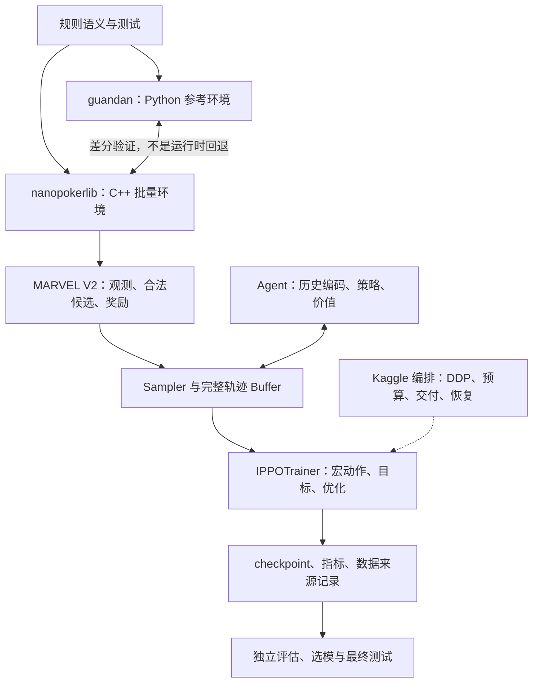
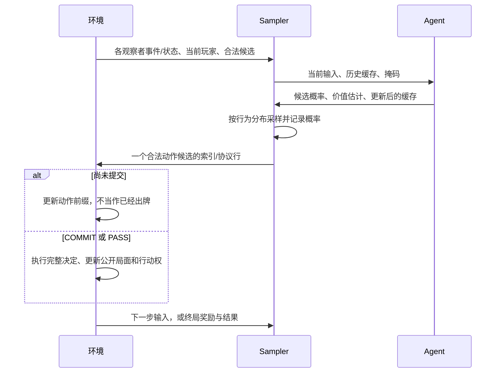

# 01 · 架构与数据流：一局牌怎样经过整个系统

[项目全景](00_overview.md) · [下一篇：训练原理](02_training.md) · [术语表](glossary.md)

> 适用范围：当前 MARVEL V2 运行时与 v1.4 宏决策 IPPO。代码核对：2026-10-21。动态状态见 [CURRENT_EXECUTION.md](../marvel_v14_prompts/CURRENT_EXECUTION.md)。本文解释结构，不证明某个后端、交付或模型已通过当前设备验证。

快速定位：[系统分层](#layers) · [一次决策](#decision) · [信息隔离](#privacy) · [轨迹字段](#trajectory) · [文件产物](#artifacts)

<a id="boundaries"></a>

## 1. 先记住四个边界

1. **规则不是策略**：引擎决定能不能出，模型决定在合法选择中怎么选。
2. **全知状态不是玩家观测**：引擎必须知道所有手牌，Actor 不可以。
3. **token 不是一次完整出牌**：动作协议把一次决定拆成多个小步骤。
4. **训练不是评估**：二者可以共用引擎，但不应共用用于结论的发牌数据。

<a id="layers"></a>

## 2. 系统分层



文字版：**规则/双后端 → V2 接口 → 采样器与模型交互 → 完整轨迹 → 训练 → 保存与评估**；Kaggle 工具负责运行编排，不定义另一套 PPO 数学。

| 目录/文件 | 主要职责 | 阅读时注意 |
|---|---|---|
| [guandan](../../guandan) | 牌、组合、轮次、状态、逐步动作和 Python 环境 | 其中也保留旧训练链，不要把所有模块当新训练入口 |
| [nanopokerlib/cpp](../../nanopokerlib/cpp) | C++ 规则/环境与 pybind 接口 | native 二进制必须与当前源文件匹配 |
| [backends.py](../../guandan_marvel/backends.py) | 显式选择 `cpp` / `python_reference` | 请求 C++ 不可用时失败，不静默转 Python |
| [game.py](../../guandan_marvel/game.py) | Python V2 适配器、协议编号、编码布局 | 历史同名导入固定指向 Python oracle |
| [env_batch.py](../../guandan_marvel/env_batch.py) | 模型运行时使用的批量步骤与结果结构 | TensorDict 转换不改变规则语义 |
| [model](../../guandan_marvel/model) | Transformer、状态/动作编码、Actor、Value、缓存 | 输入形状和信息边界比类名更重要 |
| [runtime/sampler.py](../../guandan_marvel/runtime/sampler.py) | 与环境交互、收集完整牌局、维护缓存和 provenance | 采样动作概率必须和训练记录一致 |
| [buffer.py](../../guandan_marvel/buffer.py) | 轨迹字段、缓冲区、预分配内存估算 | 容量上限不等于实际长度 |
| [training/local.py](../../guandan_marvel/training/local.py) | 本地 Trainer、更新、指标、保存与恢复 | `local` 是核心实现位置，不代表只能单机使用 |
| [evaluation](../../guandan_marvel/evaluation) | 对战、统计、晋升、身份与隔离 | 不能因为训练正常就跳过 |
| [kaggle](../../guandan_marvel/kaggle) | profile、worker、预算、source 包和 recovery | 旧交付不自动覆盖当前源码 |
| [phase5](../../guandan_marvel/phase5) / [phase6](../../guandan_marvel/phase6) | 条件功能、诊断、资格与 Gate 工具 | 文件存在不表示已启用或已正式运行 |

### 一个容易踩坑的导入细节

当前后端入口在 [guandan_marvel/__init__.py](../../guandan_marvel/__init__.py) 与 [backends.py](../../guandan_marvel/backends.py)：

| 入口 | 含义 |
|---|---|
| `get_game_backend("cpp")` / `cpp_game` | 显式 C++ |
| `get_game_backend("python_reference")` / `python_game` | 显式 Python 参考实现 |
| `get_game_backend()` / `default_game` | 当前配置的默认后端，代码默认 C++ |
| `import guandan_marvel.game` | 历史 Python 参考模块，**不是默认 C++ 的别名** |

模型和基础配置采用延迟导入，不要求单纯读取配置时就加载 native 扩展。

<a id="decision"></a>

## 3. 一次行动：从观测到提交



动作通常涉及 `FAMILY / RANK / SUIT / LENGTH / CARD / WILD_ASSIGNMENT` 等选择，实际顺序取决于协议阶段。**这些名字不是一条每次都按顺序经过的固定模板。** `PASS` 是一个长度为 1 的提交宏动作；一次普通出牌到 `COMMIT` 才提交。

相应源码：规则侧 [action_state.py](../../guandan/action_state.py)，V2 动作行构造 `game.py::_action_row`，采样侧 `Sampler.rollout_step`。

环境/机会控制步骤不属于玩家策略决策。`player_ids` 的负值用于标识非玩家步骤，不能把它们当某个座位参与策略更新。

<a id="privacy"></a>

## 4. 信息是如何隔离的？

| 信息 | 引擎可用 | 当前 IPPO Actor/Value 可用 |
|---|---|---|
| 本观察者手牌 | 是 | 是 |
| 公开出牌、行动/名次和公开上下文 | 是 | 按观测协议提供 |
| 当前玩家尚未提交的私有动作前缀 | 是 | 仅按对应观察者的可见性提供 |
| 其他玩家未公开的手牌 | 是 | 否 |
| 环境 RNG、全知状态、调试快照 | 是 | 不能作为策略输入 |

轨迹张量带有四个观察者维度，不意味着 Actor 获准把四份私有信息拼起来。模型的历史状态按观察者隔离，策略/价值分支取当前行动玩家对应的编码；相关路径在 `Agent.forward` 与基础历史编码中。

VRPO 的 centralized critic 有训练期 privileged 路径，但它不能回流为 Actor 输入；v1.4 宏决策 IPPO 的 Value Head 不应被描述成这个全知 critic。

贡还是否被规则支持、观测审计是否通过、交付 profile 是否真正采样贡还，是三个不同问题。相关代码见 [context_schedule.py](../../guandan_marvel/context_schedule.py) 和 [tribute_audit.py](../../guandan_marvel/testing/tribute_audit.py)。有完整观测审计也不能把未采样的贡还分布说成已训练。

<a id="trajectory"></a>

## 5. 一条完整轨迹装什么？

### 5.1 形状记号

- `B`：本批完整牌局条数；DDP 下先区分 global 和 per-rank。
- `T`：轨迹 token 容量；每条真实长度由 `num_steps` 指定。
- `P`：观察者/玩家数量，当前为 4。
- `A`：下一协议 token 的合法候选容量，**不是整局所有出牌组合数**。
- `L_obs` / `L_act`：一个步骤事件/候选行中的 token 容量，不是 Transformer 整段历史长度。
- `C`：结构化观测 channel 数。

| 字段 | 形状 | 含义 |
|---|---|---|
| `num_steps` | `[B]` | 真实轨迹长度，padding 不计入 |
| `obs_tokens` | `[B,T,P,L_obs]` | 每个观察者的事件 token |
| `obs_channels` | `[B,T,P,C]` | 对应观察者的结构化状态 |
| `player_ids` | `[B,T]` | 当前行动玩家或非玩家步骤标记 |
| `avail_tokens` | `[B,T,A,L_act]` | 下一协议选择的候选行 |
| `avail_weights` | `[B,T,A]` | 候选有效性/权重信息 |
| `avail_is_commit` | `[B,T,A]` | 此候选是否完成一次提交 |
| `policy_probs` | `[B,T,A]` | 当时记录的候选策略分布 |
| `behavior_action_prob` | `[B,T]` | 真正用于采样的已选动作概率 |
| `action_taken` | `[B,T]` | 被选候选的索引 |
| `on_policy_valid` | `[B,T]` | 是否满足当前 on-policy 采样契约 |
| `rewards` | `[B,T,P]` | 训练尺度、固定座位坐标的奖励 |
| `is_terminal` | `[B,T]` | 是否真实终止 |

上述为基础字段；启用对手池等功能会增加 owner/mask 字段。实际以 `trajectory_field_specs` 和运行时字段为准。

V2 标准容量在 [game.py](../../guandan_marvel/game.py) 中定义：`P=4, T=4096, A=256, L_obs=48, L_act=8, C=512`，词表容量 320。它们是当前接口上限，不是每局固定耗时、固定候选数，也不是单次模型只看 48 个历史 token。

### 5.2 为什么只收完整牌局？

`Sampler.collect` 从完成队列取得配置要求的牌局，`LocalTrainerBase._collect` 再调用完整性验证，并匹配终局信息。其他并行环境可能仍有未完成局，保存恢复时需要保留它们的状态。

宏训练不能把撞到 horizon 的半局伪装成正常终局，也不能把动作前缀的一半当完整宏动作。终止、padding、非玩家步骤和对手 owner 都要单独处理。

### 5.3 为什么训练前要估内存？

采样器既有活动 rollout buffer，也有完成轨迹缓冲。`trajectory_memory_budget` 会按 `T/A/P`、字段类型和批量计算预分配开销；它**不包含**模型、优化器、KV cache、反向激活和临时张量。算得出采样缓冲能放下，不表示整轮训练不会 OOM。

## 6. 训练器的一次调用

`IPPOTrainer.train_iteration` 根据语义 profile 分支；宏路径进入 `_macro_train_iteration`：

```text
_begin_iteration
  → 计算本轮 schedule
  → _collect：完整轨迹与真实终局信息
  → 分段：segment_rollout_macros / 对手池分段
  → 计算无梯度的宏优势与价值目标
  → epoch × minibatch 前向、损失、反向和优化
  → 更新 merged policy
  → 记录指标并推进 durable counters
```

训练器不负责自动跑到 1500 次；外层 worker/Gate runner 才决定循环次数、预算和保存时机。直接调用 `train_iteration()` 也不会因为 `checkpoint_interval` 或 `total_iterations` 配置存在就自动完成整个任务。

<a id="artifacts"></a>

## 7. 文件产物之间是什么关系？

| 产物 | 用途 | 不能代替什么 |
|---|---|---|
| resolved config / profile | 说明运行实际选择 | 不能只看 dataclass 默认值推测 |
| checkpoint | 权重及与 schema 对应的训练状态 | policy-only 文件不能当完整恢复点 |
| `metrics.jsonl` | 逐迭代训练/健康/性能读数 | 不是正式棋力结论 |
| source/native fingerprint | 绑定代码和二进制身份 | commit SHA 不能覆盖 dirty-tree 差异 |
| data provenance / manifest | 绑定发牌分布、来源和隔离域 | 只写 seed 不代表所有分布相同 |
| evaluation plan / records / summary | 指定如何对战、实际结果和统计 | 一份摘要不能补全缺失的原始局数 |
| delivery / recovery bundle | 跨会话携带源码、配置及获准产物 | 不保证新源码能 exact-resume 旧包 |

具体 checkpoint 加载边界见[操作手册](03_runbook.md)，统计和数据隔离见[评估说明](04_evaluation.md)。

## 8. 想继续追源码，按什么顺序？

1. [backends.py](../../guandan_marvel/backends.py)：环境选择。
2. [game.py](../../guandan_marvel/game.py)：观测/动作契约与参考适配。
3. [buffer.py](../../guandan_marvel/buffer.py)：字段与容量。
4. [sampler.py](../../guandan_marvel/runtime/sampler.py)：`collect`、`rollout_step`。
5. [agent.py](../../guandan_marvel/model/agent.py)：`forward` 与状态—动作融合。
6. [local.py](../../guandan_marvel/training/local.py)：`IPPOTrainer._macro_train_iteration`。
7. [checkpoints.py](../../guandan_marvel/training/checkpoints.py)：身份和恢复判断。

不要用本文的概括替代专项契约。V2 细节见 [游戏接口规范](../marvel_migration/04_GAME_INTERFACE_V2.md)，Python/C++ 一致性见 [M05 差分协议](../marvel_migration/M05_DIFFERENTIAL_PERFORMANCE_PROTOCOL.md)。
